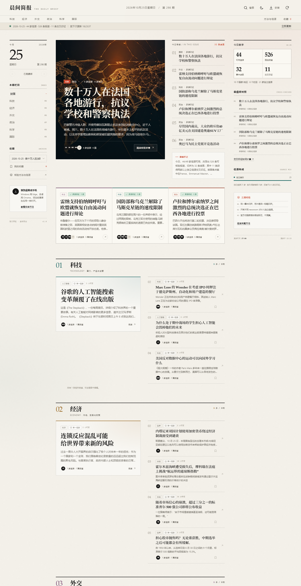
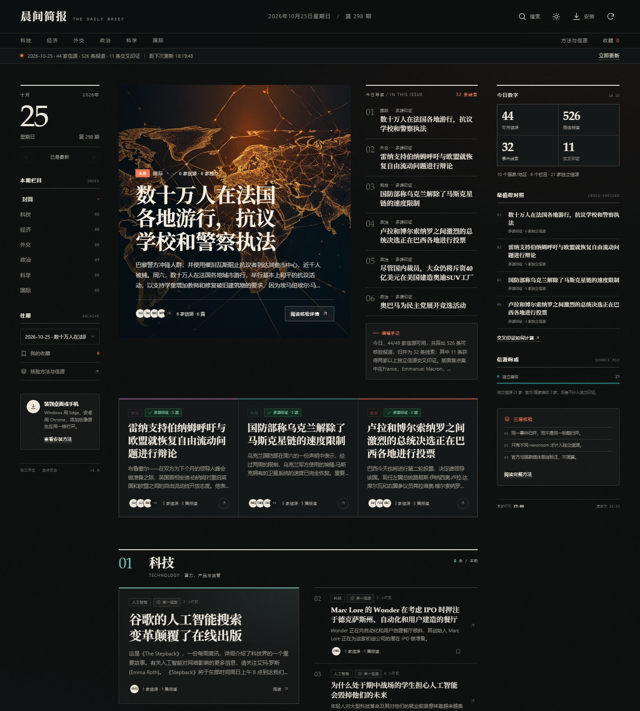
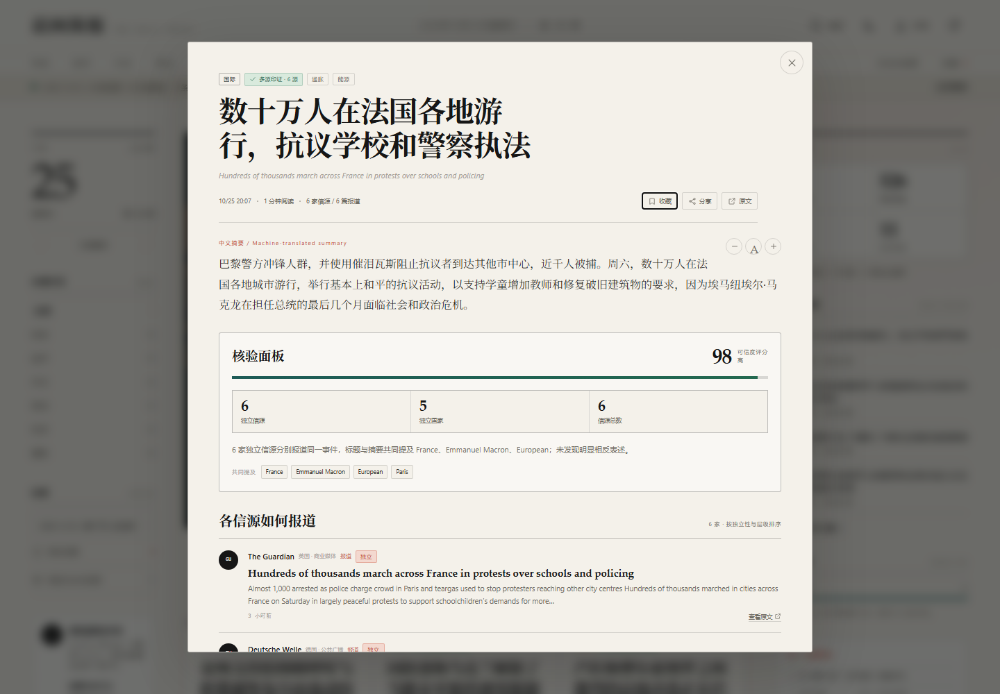

# 晨间简报 · The Daily Brief

一个可以放在自己电脑上运行的每日国际简报网站。每天 **18:30（北京时间）** 自动抓取多家国际信源，按事件聚类、计算独立信源、做交叉印证，再用中文呈现科技、经济、外交、政治、科学与国际要闻。

- **零前端依赖**：Node.js 内置模块 + 原生 HTML/CSS/JS，不需要 `npm install`。
- **跨信源核验**：同一 newsroom 不重复计数；官方机构、国家媒体、智库单独标注。
- **本地优先**：数据存在本机，不上传阅读记录，没有第三方统计脚本。
- **适配 Windows / Android**：响应式布局 + PWA，可安装到桌面或主屏幕。
- **深色模式**：跟随系统或手动切换，状态保存在本机。
- **本地生图**：优先调用本机 ComfyUI + SDXL 生成每日封面；不可用时自动使用内置 SVG 封面。
- **可离线阅读**：Service Worker 缓存最近一期，断网也能打开。



| 深色模式 | 核验详情 |
|---|---|
|  |  |

> 截图中的当期内容会随时间变化；封面由本机 ComfyUI + RealVisXL 生成。运行后以实际抓取结果为准。

---

## 1. 快速开始（Windows）

1. 安装 **Node.js 20 或更高版本**：<https://nodejs.org/>
2. 双击项目根目录的 **`start.bat`**。
3. 浏览器打开 <http://127.0.0.1:4173>。
4. 首次启动且当天还没有存档时，会自动抓取一次，通常需要 **1–3 分钟**；已有存档则直接打开。页面会显示生成进度，也可以点右上角刷新按钮强制更新。

停止服务：在启动窗口按 `Ctrl+C`。

### 手动命令

```powershell
node server.mjs                 # 启动网站（内部包含 18:30 定时器）
node scripts/refresh.mjs        # 立即生成/覆盖今天这一期
node scripts/summarize.mjs      # 只重跑 AI 摘要（不重新抓取）
node scripts/refresh.mjs 2026-10-25
node scripts/check.mjs          # 诊断网络、代理、翻译、摘要 API、生图与数据
```

### 配置

复制 `.env.example` 为 `.env` 后修改。`start.bat` 首次启动也会自动复制。

| 变量 | 默认值 | 说明 |
|---|---|---|
| `PORT` | `4173` | 网站端口 |
| `HOST` | `0.0.0.0` | 设为 `127.0.0.1` 可禁止局域网访问 |
| `UPDATE_HOUR` / `UPDATE_MINUTE` | `18` / `30` | 每日更新时间（北京时间） |
| `WINDOW_HOURS` | `36` | 只纳入最近多少小时的报道 |
| `MIN_SOURCES` | `4` | 少于这个可用信源数时拒绝发布，避免“空简报” |
| `HTTPS_PROXY` | 自动检测 | 例如 `http://127.0.0.1:7890` |
| `TRANSLATE` | `1` | `0` 关闭机器翻译，保留英文原文 |
| `IMAGE_PROVIDER` | `auto` | `auto` / `comfyui` / `svg` / `none` |
| `COMFYUI_URL` | `http://127.0.0.1:8188` | 本地 ComfyUI 地址 |
| `COMFYUI_CHECKPOINT` | `RealVisXL_V5.0_fp16.safetensors` | ComfyUI 里可用的 SDXL checkpoint 文件名 |
| `ADMIN_TOKEN` | 空 | 局域网手动刷新时需要的令牌 |

---

## 2. 每天 18:30 自动更新

网站进程内置调度器：

- 服务保持运行时，每天 **18:30** 自动生成当天的新一期；
- 如果 18:30 时电脑休眠/服务未运行，下次启动后会自动补生成；
- 如果当天 18:30 前已经生成过，18:30 会再覆盖一次，确保是“收盘版”；
- 手动刷新会覆盖当天已存在的版本。

### 可选：Windows 计划任务

如果希望 **不开着网站也能在 18:30 先抓取**，用管理员或当前用户 PowerShell 运行：

```powershell
powershell -ExecutionPolicy Bypass -File .\scripts\install-task.ps1
```

它会注册一个名为 `DailyBrief-Refresh` 的计划任务，每天 18:30 调用 `node scripts/refresh.mjs`。卸载：

```powershell
powershell -ExecutionPolicy Bypass -File .\scripts\uninstall-task.ps1
```

> 网站本身仍需运行才能访问。计划任务只是提前把数据准备好。

---

## 3. 信源与核验方法

### 信源分层

- **独立新闻编辑室**：BBC、The Guardian、NPR、Al Jazeera、France 24、DW、CBC、SCMP、The Japan Times、The Straits Times、The Indian Express、Politico、The Hill、Axios、Politico Europe、Euractiv、FT、CNBC、The Economist、MarketWatch、Ars Technica、The Verge、WIRED、MIT Technology Review、TechCrunch、IEEE Spectrum、The Register、Nature、Science、ScienceDaily、MIT News、Foreign Policy、The Diplomat、Foreign Affairs、The Moscow Times 等。
- **官方 / 国际组织**：ECB、Federal Reserve、UN News、U.S. State Department、European Commission、NASA、WHO。
- **智库**：Brookings、RAND。
- **国家媒体（保留用于对照官方立场，不计入独立印证）**：CGTN、Global Times、ECNS、TASS。

Reuters 与 AP 的公开 RSS 在当前环境下不可稳定获取，因此未纳入自动抓取；`/api/sources` 会列出“暂未纳入”的原因，而不是假装它们存在。

### 一条报道如何被核验

1. **抓取**：读取 RSS/Atom 的标题、摘要、时间、链接；过滤 36 小时之外、软新闻、观点稿与旧 feed。
2. **聚类**：标题词向量 + 实体/数字重叠，把讲同一事件的报道归并；同一 `newsroom` 的多篇稿件只算一个信源。
3. **独立印证**：≥2 家不同独立新闻编辑室 → “双源印证”；≥3 家 → “多源印证”。
4. **官方口径**：官方机构/国家媒体单独显示，不混入独立信源数量。
5. **分歧标注**：检测“否认/确认”等相反表述，标记为“表述有分歧”，保留各家原文摘录。
6. **中文编译**：标题与摘要机器翻译；专有名词、数字与语气以原文为准。

**重要边界**：交叉印证表示“多家独立 newsroom 报道了同一事件”，不代表本站独立核实了事实本身。本站不替代原始报道。

---

## 4. 新闻原图

详情页的图片来自**原新闻本身**，不是 AI 生成的配图：

1. 优先读取 RSS/Atom 的 `media:content`、`media:thumbnail`、`enclosure` 或正文内 ``；
2. 如果 RSS 没有图，再读取原文页的 `og:image` / `twitter:image` / `image_src`；
3. 仍然没有，就**不配图**，不会用每日封面或占位图冒充新闻图片；
4. 页面会标注图片来源，并链接回原新闻；
5. 图片使用原站 HTTPS 地址，`referrerpolicy="no-referrer"`，不下载到本地，避免重复存储版权图片。

```dotenv
IMAGE_LOOKUP=1
IMAGE_LOOKUP_MAX=24
IMAGE_LOOKUP_CONCURRENCY=3
IMAGE_LOOKUP_TIMEOUT_MS=12000
```

只会为重要性最高的最多 24 条“缺图或只有 140/240px 小图”的新闻做原文页补图；原文页拒绝访问、没有 OG 图或图片加载失败时，详情页自动不显示图片。RSS 自带的大图优先保留，不会重复下载。

## 5. 本地模型生成封面

默认 `IMAGE_PROVIDER=auto`：

1. 检查 `COMFYUI_URL`（默认 `http://127.0.0.1:8188`）是否可用；
2. 用配置的 SDXL checkpoint 生成一张 1344×768 的编辑插画；
3. 保存到 `data/media/covers/YYYY-MM-DD.png`，并在当期 JSON 中引用；
4. ComfyUI 不可用、超时或生成失败 → 自动回退到内置的程序化 SVG 封面（不是外链图片）。

启动 ComfyUI（示例路径，按你的安装调整）：

```powershell
cd G:\deepseekwork\ai\ComfyUI
..\venv\Scripts\python.exe main.py --listen 127.0.0.1 --port 8188 --cpu-vae
```

- 如果 AMD GPU 在 VAE 解码阶段崩溃（`miopen ... unspecified launch failure`），加 `--cpu-vae` 把 VAE 放到 CPU；扩散仍在 GPU 上。
- 如果显存不足，把 `COMFYUI_STEPS` 降到 `20`，或把 `src/image.mjs` 里的 `width/height` 改为 `1024/576`。
- 封面提示词刻意避开文字、国旗、人脸，避免生成不可控的新闻图像；它是**编辑插画**，不是事件现场照片。
- 没有 ComfyUI 也完全可用；SVG 封面会根据日期和当日标签生成不同的地形线与色彩。

### AI 摘要 API（重点）

抓取只是原料。真正生成“今日简报”的是 `src/summarize.mjs`：它会把每个事件簇的信源标题、短摘要、核验信息发给一个 **OpenAI 兼容 API** 或 **Ollama**，要求模型输出严格 JSON：

- `headline`：中文标题
- `summary`：2–4 句中文摘要，交代谁、何时、发生了什么、确认到什么程度
- `why_it_matters`：一句为什么重要
- `key_facts`：最多 3 条材料中明确出现的事实
- `confidence`：high / medium / low

摘要提示词强制三条边界：

1. 只使用提供的 RSS 标题与短摘要，不允许补写事实、数字或引语；
2. 材料有冲突时必须写“存在不同表述”，不替任何一方下结论；
3. 模型没有读取新闻全文，原文链接始终保留。

快捷配置（只把 key 写入本机 `.env`，不会回显）：

```powershell
powershell -ExecutionPolicy Bypass -File .\scripts\configure-llm.ps1
```

也可以手动编辑 `.env`。配置示例（写入 `.env`，然后运行 `node scripts/refresh.mjs`）：

```dotenv
# DeepSeek
LLM_PROVIDER=openai
LLM_BASE_URL=https://api.deepseek.com/v1
LLM_API_KEY=sk-...
LLM_MODEL=deepseek-chat

# 或 OpenAI
# LLM_BASE_URL=https://api.openai.com/v1
# LLM_MODEL=gpt-4o-mini

# 或本机 LM Studio（无需 key）
# LLM_PROVIDER=openai
# LLM_BASE_URL=http://127.0.0.1:1234/v1
# LLM_MODEL=你已加载的模型名

# 或本机 Ollama（无需 key）
# LLM_PROVIDER=ollama
# LLM_BASE_URL=http://127.0.0.1:11434
# LLM_MODEL=qwen2.5:7b
```

- 默认只摘要重要性最高的 `LLM_MAX_STORIES=24` 条，按 `LLM_BATCH_SIZE=5` 分批调用，控制费用与延迟；
- API 失败/未配置时，自动回退到 RSS 摘要 + Google 翻译，页面不会空白；
- 页面会显示“AI 摘要 N 条”；详情页会标注模型名、置信度、“为什么重要”和“AI 摘要仅基于标题/短摘要”；
- 摘要 API 的调用是**服务端**完成的，API key 不会进入浏览器；
- 如果你不想把新闻标题发给第三方，使用本地 LM Studio/Ollama，或设置 `LLM_PROVIDER=none`。

> 当前 `.env` 已配置 DeepSeek，摘要调用成功后会写入 `edition.aiSummary`，页面显示“AI 综合”。如果更换机器或 key 失效，按上面的配置重新填写即可；失败时会自动回退，不会影响出刊。

中文翻译部分使用 Google 翻译公开端点（可 `TRANSLATE=0` 关闭），并缓存到 `data/cache/translations.json`。翻译只用于 AI 摘要没有覆盖的条目。

---

## 6. 安卓 / Windows 安装

### Windows

- 用 **Edge** 或 **Chrome** 打开 `http://127.0.0.1:4173`；
- 地址栏右侧出现“安装”图标，或右键页面 →“安装为应用”；
- 安装后从开始菜单/任务栏启动，独立窗口运行。

### Android

- 电脑和手机连同一个 Wi-Fi；
- 启动窗口会打印 `LAN: http://192.168.x.x:4173`，手机浏览器打开它；
- Chrome 菜单 →“添加到主屏幕 / 安装应用”；
- **注意**：Chrome 只在 HTTPS 或 localhost 下启用完整 PWA 安装。局域网 HTTP 地址通常只能创建快捷方式；要获得完整离线安装体验，请把服务部署到 HTTPS（例如反向代理 + 证书），或使用支持 HTTPS 的托管平台。

如果手机打不开：检查 Windows 防火墙是否允许 Node.js 的“专用网络”入站；不要使用 `127.0.0.1` 给手机访问。也可以管理员运行：

```powershell
powershell -ExecutionPolicy Bypass -File .\scripts\open-firewall.ps1
```

它只对“专用网络”开放 TCP 4173 端口。

---

## 7. 数据与接口

```
data/
  editions/YYYY-MM-DD.json   # 每一期的完整数据（信源、核验、翻译、封面）
  media/covers/              # 本地生成或程序化封面
  cache/translations.json    # 翻译缓存
  logs/pipeline-*.json       # 每次抓取的诊断日志
  state.json                 # 最近一次成功/失败状态
```

接口（只读，除手动刷新）：

- `GET /api/editions` — 往期列表
- `GET /api/editions/latest` — 最新一期
- `GET /api/editions/2026-10-25` — 指定日期
- `GET /api/status` — 更新时间、倒计时、信源健康、代理状态
- `GET /api/sources` — 信源注册表 + 本期抓取状态
- `POST /api/refresh` — 本机触发；局域网需 `X-Admin-Token`

手动刷新示例：

```powershell
curl.exe -X POST http://127.0.0.1:4173/api/refresh -H "Content-Type: application/json" -d "{}"
```

---

## 8. 项目结构

```
daily-brief/
  server.mjs              # HTTP 服务 + API + 静态文件
  src/
    sources.mjs           # 49 家信源注册表（分层、国别、独立性）
    fetch.mjs             # 直连/系统代理、重定向、gzip、chunked
    rss.mjs               # RSS 2.0 / Atom / RDF 解析
    analyze.mjs           # 分类、聚类、核验评分、版面组装
    summarize.mjs         # DeepSeek / OpenAI / Ollama 摘要
    article-media.mjs     # RSS 原图 + og:image 原文补图
    translate.mjs         # 中文翻译 + 缓存
    image.mjs             # ComfyUI 生图 + SVG 降级
    pipeline.mjs          # 抓取→筛选→聚类→补图→摘要→封面→落盘
    scheduler.mjs         # 每日 18:30 调度与补跑
  public/                 # PWA 前端（无构建步骤）
  scripts/                # 手动刷新、诊断、图标、计划任务
```

---

## 9. 常见问题

**Q：启动后一直显示“正在生成”？**
首次运行要抓 49 个 feed，再翻译、生图，1–3 分钟正常。若超过 5 分钟，打开 `data/logs/pipeline-*.json` 或运行 `node scripts/check.mjs`。

**Q：很多信源抓取失败？**
先确认浏览器能打开对应网站。若使用代理，在 `.env` 设置 `HTTPS_PROXY`；本程序会优先直连，失败后走代理，也支持系统代理自动探测（Windows）。

**Q：翻译很慢或失败？**
Google 翻译端点可能限流。把 `TRANSLATE=0`，或减小 `TRANSLATION_LIMIT`；已翻译内容会缓存，之后不会重复请求。

**Q：没有生成封面？**
检查 ComfyUI 是否启动、`COMFYUI_CHECKPOINT` 是否是 `ComfyUI/models/checkpoints` 下的真实文件名。失败会自动回退 SVG，不会阻塞出刊。

**Q：端口被占用？**
在 `.env` 改 `PORT=4174`，重启。

**Q：能否部署到公网？**
可以，任何能跑 Node 20 的环境都行。注意：公网部署时请设置 `HOST=0.0.0.0`、`ADMIN_TOKEN`，并在反向代理层加 HTTPS 与访问控制。`data/` 会包含抓取内容，请遵守各信源的使用条款。

---

## 10. 版权与使用

- 本站只存储标题、短摘要与原文链接，用于新闻索引与交叉核对；版权归原信源所有。
- 封面插画由本地模型或程序生成，不含新闻现场照片。
- 不提供事实仲裁，不构成投资、法律或政治建议。
- 请尊重各信源的 robots.txt 与订阅条款；不要高频抓取。
